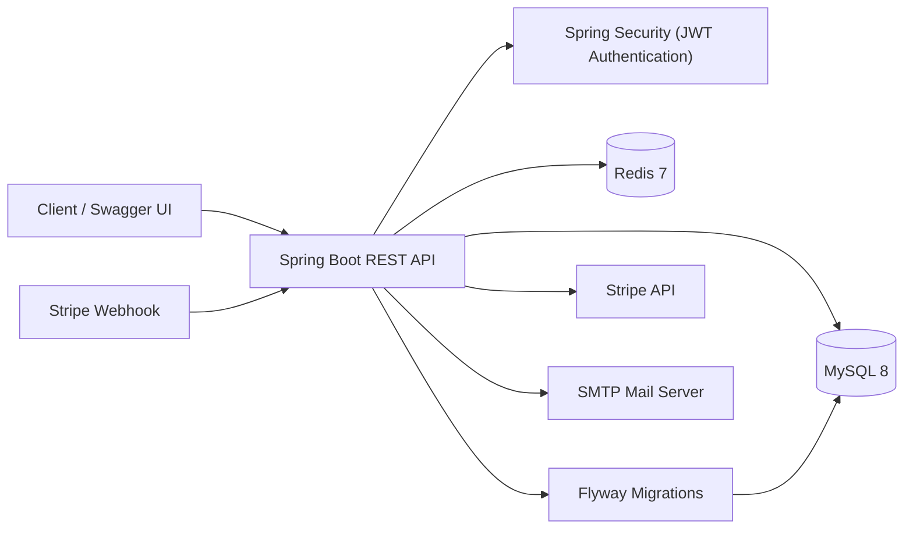

# E-Commerce REST API

A Spring Boot e-commerce backend built as a deep dive into backend engineering: authentication and authorization, transactional checkout, Stripe payment webhooks, Redis-backed email verification, rate limiting, and containerized setup with Docker Compose.

**API reference (static):** https://tchiwara.github.io/ecommerce-api/

## Architecture



## Tech stack

- Java 17, Spring Boot 4.1, Spring Security (JWT), Spring Data JPA
- MySQL 8 with Flyway migrations
- Redis for email OTP verification state and rate limiting
- Stripe Checkout with signed webhooks
- MapStruct, Lombok, springdoc-openapi (Swagger UI)
- JUnit 5 and Mockito
- Docker and Docker Compose

## Features

- Register with email OTP verification, login with JWT, and role-based access for customers and administrators
- Product and category catalog with pagination and sorting
- Per-user shopping cart
- Checkout with stock handling and order history
- Stripe payments: an order is marked paid by a verified webhook, then a confirmation email is sent
- Rate limiting on login, registration, OTP, and public endpoints
- Stripe webhooks are exempt from application rate limiting
- Centralized error handling with consistent responses

## Design decisions

- **Feature-based packages:** Packages such as `cart`, `order`, `product`, and `user` keep each feature's code self-contained.
- **Rich Cart domain model:** The cart is the aggregate root and owns add, remove, quantity, and total-calculation rules.
- **Payment confirmed only by webhook:** The Stripe success redirect never marks an order as paid; only a verified Stripe webhook can do that.
- **OTP state in Redis:** Short-lived Redis keys use TTLs and atomic counters for verification attempts and resend limits. The OTP is stored as an HMAC hash.
- **Role carried in the JWT claim:** This avoids a database lookup on every request, although role changes take effect after the current token expires.
- **Flyway for the schema:** The database schema is created and updated through versioned migrations.

## Running locally with Docker Compose

**Requirements:** Docker, the [Stripe CLI](https://docs.stripe.com/stripe-cli), a free Stripe account in test mode, and a Gmail account with an App Password.

### 1. Configure

```bash
cp .env.example .env
```

Fill in `.env`:

- `JWT_SECRET` and `OTP_SECRET`: generate each with `openssl rand -base64 48`
- `MAIL_USERNAME` and `MAIL_PASSWORD`: Gmail address and App Password required for OTP verification
- `STRIPE_SECRET_KEY`: your Stripe test key, such as `sk_test_...`
- `STRIPE_WEBHOOK_SECRET`: the signing secret printed by the Stripe CLI in step 3

### 2. Start the stack

```bash
docker compose up --build
```

Swagger UI:

```text
http://localhost:8080/swagger-ui.html
```

### 3. Forward Stripe webhooks

In a separate terminal, run:

```bash
stripe listen \
  --events checkout.session.completed,checkout.session.expired,payment_intent.payment_failed \
  --forward-to localhost:8080/payments/webhook
```

The CLI prints a signing secret beginning with `whsec_`.

Put that value in `STRIPE_WEBHOOK_SECRET` in `.env`, then restart the API:

```bash
docker compose up -d
```

### 4. Try the full flow in Swagger UI

1. Call `POST /users` to register.
2. Verify the OTP sent to your email.
3. Call `POST /auth/login`.
4. Copy the access token.
5. Click **Authorize** in Swagger UI and paste the token.
6. Add products to the cart with `POST /cart/items`.
7. Call `POST /orders/checkout` to create an order.
8. Call the payment-session endpoint to receive a Stripe Checkout URL.
9. Open the Checkout URL in your browser.
10. Pay with Stripe's test card:

```text
4242 4242 4242 4242
```

Use any future expiry date and any CVC.

After payment, Stripe sends a webhook to the API. The order should transition to `PAID`, and a confirmation email should be sent.

## Creating an administrator

Register and verify a user, then promote the user with MySQL:

```bash
docker compose exec mysql mysql -uroot -p ecommerce_db \
  -e "UPDATE users SET role='ADMIN' WHERE email='you@example.com';"
```

Log in again to receive a JWT containing the updated role.

## Notes

- Browsing, cart operations, and checkout creation work without Stripe.
- Payment confirmation requires a valid Stripe webhook.
- The `STRIPE_WEBHOOK_SECRET` must match the signing secret used by the Stripe CLI.
- `DB_PASSWORD` only takes effect when the MySQL volume is first created.
- `docker compose down -v` deletes the MySQL database volume and all stored database data.
- Redis data is disposable because OTP and rate-limit values are temporary.

## Tests

```bash
mvn test
```

## API documentation

The static API reference is available at:

https://tchiwara.github.io/ecommerce-api/

When running locally, Swagger UI is available at:

http://localhost:8080/swagger-ui.html
